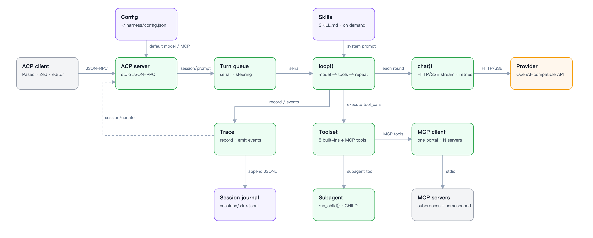

# harness

[](https://github.com/paul2xfffff/paseo-harness/actions/workflows/test.yml)

> **English** — A single-file ACP coding agent backend in under 2000 lines: one model loop, five tools (including `subagent`), a built-in MCP client, and on-demand skills — no framework.
> **中文** — 单文件 ACP 编码 agent 后端，不到 2000 行：一个模型循环、五个工具（含 `subagent`）、内置 MCP 客户端与按需加载的 skills，无框架。

Single-file coding agent backend. Speaks ACP (JSON-RPC) over stdio, so any ACP client
(Paseo, Zed, editor plugin) can drive it.

Scope: personal use — runs as the ACP provider behind Paseo; a local process, no hosting.

**under 2000 lines. 3 dependencies. No framework.**

[中文说明](README.zh-CN.md)



Diagram source: [docs/architecture.en.svg](docs/architecture.en.svg).

## Design

Most agent frameworks = service + plugin registry + config schema. This is a model loop +
5 tools + a protocol adapter, in one file.

- **5 tools**: `read` / `bash` / `edit` / `write` / `subagent`, schema < 900 tokens
- **1 session = 1 JSONL journal**, folded on load
- **Context compaction** at `context - reserve` of the model entry, keeps the recent tail
- **MCP client** built in: stdio servers map to tools
- **Skills**: markdown instructions loaded on demand, not injected wholesale

## Install

Python 3.10+ (`mcp` requires it).

```bash
# from this checkout
python3 -m venv .venv
.venv/bin/pip install -r requirements.txt
```

## Run

```bash
export OPENAI_BASE_URL=https://api.openai.com/v1
export OPENAI_API_KEY=sk-...
export AGENT_MODEL=gpt-4o-mini
.venv/bin/python agent.py acp
```

`agent.py acp` reads JSON-RPC on stdin, writes on stdout. Smoke test by hand:

```bash
printf '%s\n' \
  '{"jsonrpc":"2.0","id":1,"method":"initialize","params":{"protocolVersion":1,"clientCapabilities":{}}}' \
  '{"jsonrpc":"2.0","id":2,"method":"session/new","params":{"cwd":"/tmp","mcpServers":[]}}' \
  | .venv/bin/python agent.py acp
```

The `bash` tool runs `/bin/bash`; on Windows use WSL. Everything else is plain Python.

## Configure

Config file: `$AGENT_CONFIG`, else `~/.harness/config.json`. The path goes through expanduser,
so the same file works on macOS / Linux / Windows.

```json
{
  "default": "openai/gpt-4o-mini",
  "providers": {
    "openai": {
      "base_url": "env:OPENAI_BASE_URL",
      "api_key": "env:OPENAI_API_KEY",
      "models": {
        "gpt-4o-mini": { "context": 128000, "max_output": 16384,
                         "input_cost": 0.15, "output_cost": 0.6 }
      }
    }
  },
  "mcpServers": {
    "tavily": { "command": "npx", "args": ["-y", "tavily-mcp"],
                "env": { "TAVILY_API_KEY": "tvly-..." } }
  },
  "settings": { "approval": "ask", "max_steps": 40, "max_jobs": 4 }
}
```

`env:VAR` reads the value from the environment, so the file never holds a key.

Every shipped default is settable under `settings`; the same-named uppercase `AGENT_*` env var
wins. Precedence: env > `settings` > built-in default.

| key | default | meaning |
|---|---|---|
| `max_lines` | `2000` | lines the `read` tool returns |
| `max_bytes` | `50000` | bytes one clipped tool result keeps |
| `max_tokens` | `65536` | completion budget per model call |
| `context_window` | `524288` | default context window |
| `reserve_tokens` | `16384` | room kept free for one full completion |
| `keep_tokens` | `20000` | recent tail compaction keeps |
| `image_tokens` | `1200` | estimated tokens per image |
| `max_image_bytes` | `10000000` | largest image the `read` tool accepts |
| `max_bash_timeout` | `600` | ceiling for a `bash` timeout, seconds |
| `max_jobs` | `8` | concurrent background jobs |
| `max_pending` | `8` | child reports kept while the parent is idle |
| `max_steps` | `0` | turn limit, `0` = unlimited |
| `max_budget` | `0` | USD limit, `0` = unlimited |
| `max_errors` | `5` | consecutive tool errors before a turn stops |
| `max_repeats` | `6` | identical tool calls before a turn stops |
| `permission_timeout` | `300` | seconds to wait for a permission answer |
| `trace_max_bytes` | `64000000` | journal size before it folds |
| `summary_tool_chars` | `2000` | tool text kept in a compaction summary |
| `context_safety_tokens` | `4096` | headroom subtracted before a call |
| `reasoning_effort` | `high` | `off` / `low` / `high` / `max` |

Per-model entries override the global `settings` for that model: `context`, `max_output`,
`reserve`, `keep_recent`, `reasoning`, `reasoning_history`, `vision`, `selectable`, and the
four `*_cost` fields.

## Skills

A skill = a directory containing `SKILL.md`:

```
.agents/skills/pdf/
  SKILL.md
  scripts/extract.py
```

```markdown
---
name: pdf
description: Use when reading or editing PDF files
---

# PDF

Run `scripts/extract.py` against the target file.
```

Search order, first match wins:

1. `<cwd>/.harness/skills/`
2. `<cwd>/.agents/skills/`
3. `~/.harness/skills/`
4. `~/.agents/skills/`

**Manual by default.** Skills show up as `/skill:pdf` in the client's command list; picking one
injects the instructions. Only a skill declaring `model-invocable: true` is listed in the system
prompt — 30 installed skills cost ~3900 prompt tokens on every turn, and the model rarely calls
one unprompted.

## Commands

Sent as a normal prompt:

| | |
|---|---|
| `/cost` | session tokens and estimated cost |
| `/compact [focus]` | compact older context now |
| `/reload` | re-read project context and skills |
| `/approval auto\|ask\|deny` | tool approval policy |
| `/skill:<name>` | load a skill's instructions |

Self-answering commands (`/compact`, `/cost`, `/reload`, `/approval`, unknown skill) return `""`
from `run_command` and do **not** burn a model turn. A message that starts with `/` but matches
no command is sent to the model as text.

## How it works

```
ACP (JSON-RPC)  ->  turn queue  ->  loop()  ->  chat()  ->  provider
                                      |
                                      +->  tools: read bash edit write subagent
                                      +->  MCP tools (namespace mcp__<server>__<tool>)
```

- **`loop()`**: one turn = call model → run tools → repeat until no tool calls. Compacts when the
  context crosses the model's `context - reserve`, so the window never fills mid-completion.
- **`Trace`**: per-session journal + ACP event outlet. Owns the run's reads, background jobs and
  subagents; `close()` releases them.
- **`Toolset`**: the tools one run may declare/execute. `CHILD` = the same set minus `subagent`;
  the lookup itself is the recursion guard.
- **Background work** (bash jobs, subagents) reports to the parent run when it finishes. Mid-turn
  the result continues the same turn; idle it is queued *and* wakes the session with a new turn.
- **MCP**: one portal thread, one event loop for N servers.

Sessions are one JSONL per conversation under `~/.harness/sessions/`, never inside the
workspace. `AGENT_SESSIONS` overrides the directory. Journals written before the move are still
read from `<cwd>/.harness/sessions/` as a fallback. One event per line, folded on load;
`AGENT_TRACE_MAX_BYTES` bounds the file. Nothing deletes old journals: prune them yourself.

## Environment

Every knob has a default. The ones you'll actually touch:

| | default | |
|---|---|---|
| `OPENAI_BASE_URL` | `https://api.openai.com/v1` | any OpenAI-compatible endpoint |
| `OPENAI_API_KEY` | — | required |
| `AGENT_MODEL` | first in config | `provider/model` |
| `AGENT_APPROVAL` | `auto` | `auto` / `ask` / `deny` |
| `AGENT_CONFIG` | `~/.harness/config.json` | models + MCP + settings |
| `AGENT_SESSIONS` | `~/.harness/sessions` | where session journals live |
| `AGENT_MAX_BASH_TIMEOUT` | `600` | seconds |
| `AGENT_MAX_JOBS` | `8` | concurrent background jobs |
| `AGENT_MAX_SUBAGENTS` | `3` | concurrent subagents |
| `AGENT_MCP_TIMEOUT` | `30` | per-server startup and per-call |

The rest are in the module docstring. Any `settings` key above can be set the same way.

## Tests

No framework. Each `test_*.py` is a script that asserts and prints; non-zero exit is failure.

```bash
.venv/bin/python tests/run.py          # 22 tests (the live suite skips without LIVE_API_KEY)
.venv/bin/python tests/run.py tools    # just the ones matching "tools"
```

The ACP tests are **not mocked**: each starts a driver that replaces `agent.chat` with a
scripted response and runs the real `acp_main()` — real JSON-RPC over a pipe, real session
files, real permission prompts. Only the model is fake.

`tests/test_live.py` runs the same handlers against a real endpoint:

```bash
LIVE_BASE_URL=http://localhost:11434/v1 LIVE_MODEL=gpustack/qwen3-coder LIVE_API_KEY=... \
    .venv/bin/python tests/test_live.py
```

`tests/test_regressions.py` is the one to read first. It pins every failure this codebase
actually had: a command that burned a model turn, a subagent whose background output vanished,
a session that leaked its jobs when saving failed, a skill description that could break out of
the prompt's XML.

## Non-goals

- **Not a library** — importable and callable via `ACP()`, but the entry point is
  `python agent.py acp`. `settings()` raises instead of exiting, so callers can catch it.
- **Not multi-tenant** — one process, one user's sessions; no auth between sessions.
- **No MCP reconnect** — a server that dies stays dead; calls fail fast with the reason.
- **No remote transport** — stdio only; HTTP/SSE MCP servers are rejected with a message.

## License

MIT — see `LICENSE`.
