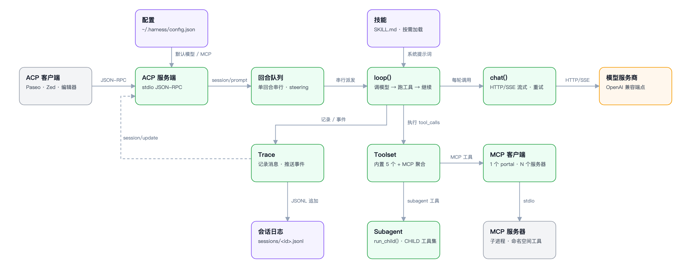

# harness

[](https://github.com/paul2xfffff/paseo-harness/actions/workflows/test.yml)

单文件编码 agent 后端。通过 stdio 讲 ACP（JSON-RPC），可被任意 ACP 客户端（Paseo、Zed、编辑器插件）驱动。

用途：个人作为 Paseo 的 ACP provider，本地进程，无托管。

**不到 2000 行，3 个依赖，无框架。**

[English](README.md)



源文件：[docs/architecture.zh-CN.svg](docs/architecture.zh-CN.svg)。

## 设计取舍

多数 agent 框架 = 服务 + 插件注册表 + 配置 schema。这里是模型循环 + 5 个工具 + 协议适配，单文件。

- **5 个工具**：`read` / `bash` / `edit` / `write` / `subagent`，schema < 900 token
- **1 会话 = 1 JSONL journal**，加载时折叠
- **上下文压缩**：阈值为模型条目的 `context - reserve`
- **MCP 客户端**内置：stdio server 直接映射为工具
- **Skills**：markdown 指令按需加载，默认不进系统提示词

## 安装

Python 3.10+（`mcp` 的最低要求）。

```bash
# 在本仓库根目录
python3 -m venv .venv
.venv/bin/pip install -r requirements.txt
```

## 运行

```bash
export OPENAI_BASE_URL=https://api.openai.com/v1
export OPENAI_API_KEY=sk-...
export AGENT_MODEL=gpt-4o-mini
.venv/bin/python agent.py acp
```

`agent.py acp` 从 stdin 读 JSON-RPC，往 stdout 写。手工冒烟：

```bash
printf '%s\n' \
  '{"jsonrpc":"2.0","id":1,"method":"initialize","params":{"protocolVersion":1,"clientCapabilities":{}}}' \
  '{"jsonrpc":"2.0","id":2,"method":"session/new","params":{"cwd":"/tmp","mcpServers":[]}}' \
  | .venv/bin/python agent.py acp
```

`bash` 工具调用 `/bin/bash`；Windows 请用 WSL。其余都是纯 Python。

## 配置

配置文件：`$AGENT_CONFIG`，否则 `~/.harness/config.json`。路径经 expanduser，macOS / Linux / Windows 通用。

```json
{
  "default": "openai/gpt-4o-mini",
  "providers": {
    "openai": {
      "base_url": "env:OPENAI_BASE_URL",
      "api_key": "env:OPENAI_API_KEY",
      "models": {
        "gpt-4o-mini": { "context": 128000, "max_output": 16384,
                         "input_cost": 0.15, "output_cost": 0.6 }
      }
    }
  },
  "mcpServers": {
    "tavily": { "command": "npx", "args": ["-y", "tavily-mcp"],
                "env": { "TAVILY_API_KEY": "tvly-..." } }
  },
  "settings": { "approval": "ask", "max_steps": 40, "max_jobs": 4 }
}
```

`env:VAR`：值从环境变量取，文件里不落 key。

所有默认值都可放进 `settings`；同名大写 `AGENT_*` 环境变量优先级更高。优先级：env > `settings` > 内置默认。

| 键 | 默认值 | 含义 |
|---|---|---|
| `max_lines` | `2000` | `read` 单次返回行数 |
| `max_bytes` | `50000` | 单个工具结果裁剪后的字节数 |
| `max_tokens` | `65536` | 单次补全预算 |
| `context_window` | `524288` | 默认上下文窗口 |
| `reserve_tokens` | `16384` | 为一次完整补全预留的 token |
| `keep_tokens` | `20000` | 压缩保留的最近 tail |
| `image_tokens` | `1200` | 单图 token 估算 |
| `max_image_bytes` | `10000000` | `read` 接受的图片上限 |
| `max_bash_timeout` | `600` | `bash` 超时上限（秒） |
| `max_jobs` | `8` | 并发后台任务数 |
| `max_pending` | `8` | 父回合 idle 时保留的子代理结果数 |
| `max_steps` | `0` | 回合上限，`0` = 不限 |
| `max_budget` | `0` | USD 上限，`0` = 不限 |
| `max_errors` | `5` | 连续工具错误上限 |
| `max_repeats` | `6` | 相同工具调用重复上限 |
| `permission_timeout` | `300` | 等待权限应答（秒） |
| `trace_max_bytes` | `64000000` | journal 折叠阈值 |
| `summary_tool_chars` | `2000` | 压缩摘要保留的工具文本长度 |
| `context_safety_tokens` | `4096` | 调用前预留的安全余量 |
| `reasoning_effort` | `high` | `off` / `low` / `high` / `max` |

模型条目可覆盖全局 `settings`：`context`、`max_output`、`reserve`、`keep_recent`、`reasoning`、`reasoning_history`、`vision`、`selectable`，以及 4 个 `*_cost` 字段。

## Skills

一个 skill = 一个含 `SKILL.md` 的目录：

```
.agents/skills/pdf/
  SKILL.md
  scripts/extract.py
```

```markdown
---
name: pdf
description: Use when reading or editing PDF files
---

# PDF

Run `scripts/extract.py` against the target file.
```

搜索顺序，首个命中生效：

1. `<cwd>/.harness/skills/`
2. `<cwd>/.agents/skills/`
3. `~/.harness/skills/`
4. `~/.agents/skills/`

**默认手动触发**：以 `/skill:pdf` 出现在客户端命令列表，选中才注入指令。只有声明 `model-invocable: true` 的才会进系统提示词 —— 30 个 skill 常驻约 3900 token，模型基本不会主动调用。

## 命令

以普通 prompt 发送：

| | |
|---|---|
| `/cost` | 会话 token 与估算开销 |
| `/compact [focus]` | 立即压缩较早上下文 |
| `/reload` | 重新读取项目上下文与 skills |
| `/approval auto\|ask\|deny` | 工具审批策略 |
| `/skill:<name>` | 注入指定 skill 的指令 |

自答命令（`/compact`、`/cost`、`/reload`、`/approval`、不存在的 skill）由 `run_command` 返回 `""`，**不消耗**模型回合。仅以 `/` 开头但不匹配命令的消息，原样发给模型。

## 实现结构

```
ACP (JSON-RPC)  ->  turn queue  ->  loop()  ->  chat()  ->  provider
                                     |
                                     +->  tools: read bash edit write subagent
                                     +->  MCP tools (namespace mcp__<server>__<tool>)
```

- **`loop()`**：一个回合 = 调模型 → 跑工具 → 循环，直到无工具调用。上下文越过模型的 `context - reserve` 即压缩，避免补全中途撑满窗口。
- **`Trace`**：per-session journal + ACP 事件出口。持有本次 run 的读记录、后台任务、子代理；`close()` 统一释放。
- **`Toolset`**：一次 run 可声明/执行的工具集。`CHILD` = 同集合去掉 `subagent`，递归护栏由查表本身保证。
- **后台任务**（bash 后台、subagent）结束后回传结果：父回合在跑就并入当轮；已经停了就入队，并由 agent 自己起一个新回合提醒模型，不用等用户再发消息。
- **MCP**：一条 portal 线程 + 一个事件循环管理 N 个 server。

会话按对话存为 1 个 JSONL，统一放在 `~/.harness/sessions/`，不写进工作目录。旧版本写在 `<cwd>/.harness/sessions/` 的 journal 仍可读（回退查找）。可用 `AGENT_SESSIONS` 覆盖目录。每行一个事件，加载时折叠；`AGENT_TRACE_MAX_BYTES` 控制折叠阈值。没有自动清理：目录会持续增长，需要手动删旧 journal。

## 环境变量

每个开关都有默认值。常用项：

| | 默认值 | |
|---|---|---|
| `OPENAI_BASE_URL` | `https://api.openai.com/v1` | 任意 OpenAI 兼容端点 |
| `OPENAI_API_KEY` | — | 必填 |
| `AGENT_MODEL` | 配置里的第一个 | `provider/model` |
| `AGENT_APPROVAL` | `auto` | `auto` / `ask` / `deny` |
| `AGENT_CONFIG` | `~/.harness/config.json` | 模型 + MCP + settings |
| `AGENT_SESSIONS` | `~/.harness/sessions` | 会话 journal 目录 |
| `AGENT_MAX_BASH_TIMEOUT` | `600` | 秒 |
| `AGENT_MAX_JOBS` | `8` | 并发后台任务 |
| `AGENT_MAX_SUBAGENTS` | `3` | 并发子代理 |
| `AGENT_MCP_TIMEOUT` | `30` | 单 server 启动 / 单次调用 |

其余见模块 docstring。上表任一 `settings` 键都可用同样方式设置。

## 测试

无框架。每个 `test_*.py` 为独立脚本，断言 + 打印；退出码非 0 即失败。

```bash
.venv/bin/python tests/run.py          # 21 个测试（live 套件在没有 LIVE_API_KEY 时跳过）
.venv/bin/python tests/run.py tools    # 只跑名字匹配 "tools" 的
```

ACP 测试不做 mock：每个测试启动 driver，替换 `agent.chat` 为脚本化响应，跑真实 `acp_main()` —— 真实管道 JSON-RPC、真实会话文件、真实审批请求。只有模型是假的。

`tests/test_live.py` 用同一套 handler 打真实端点：

```bash
LIVE_BASE_URL=http://localhost:11434/v1 LIVE_MODEL=gpustack/qwen3-coder LIVE_API_KEY=... \
    .venv/bin/python tests/test_live.py
```

`tests/test_regressions.py` 优先阅读，固定了本仓库真实出现过的故障：空耗模型回合的命令、子代理后台输出丢失、保存失败时泄漏作业的会话、可从提示词 XML 逃逸的 skill description。

## 非目标

- **不是库**：可以 import 并调用 `ACP()`，但入口是 `python agent.py acp`。`settings()` 抛异常而非退出，便于上层捕获。
- **非多租户**：单进程、单用户会话，会话间无鉴权。
- **MCP 不重连**：server 退出后不会拉起；调用快速失败并报错。
- **无远程传输**：仅 stdio；HTTP/SSE MCP server 直接拒绝并说明原因。

## 许可

MIT，见 `LICENSE`。
